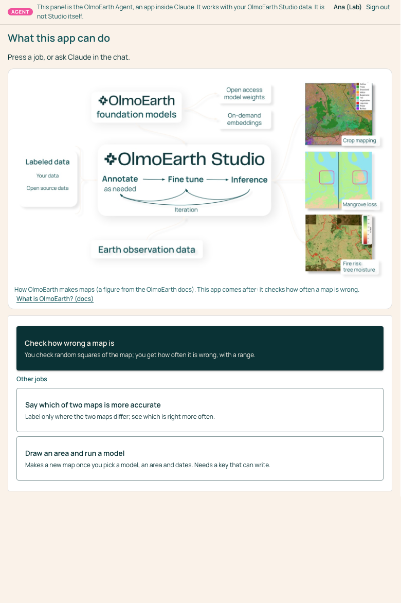
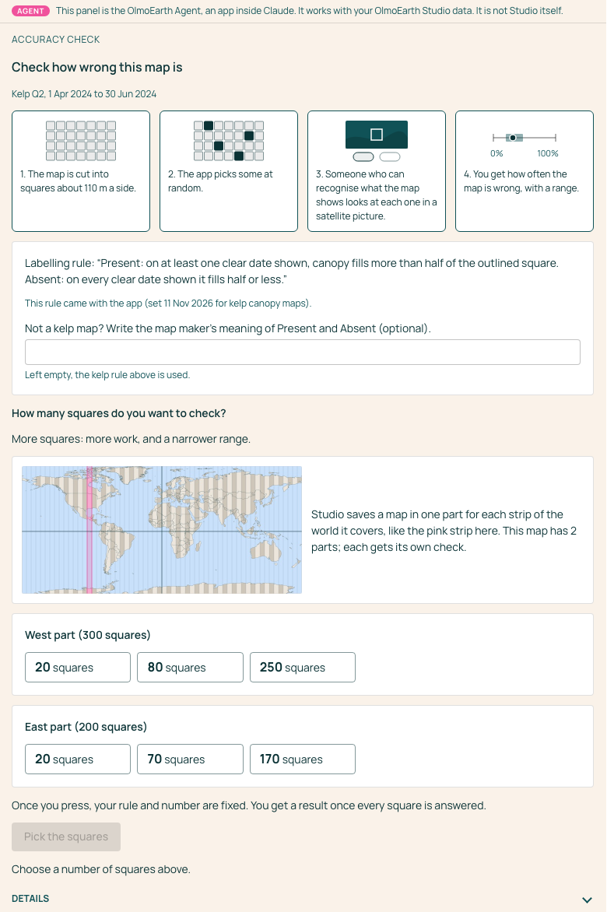
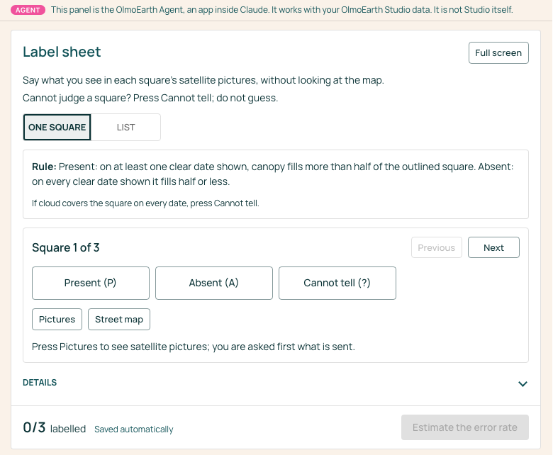
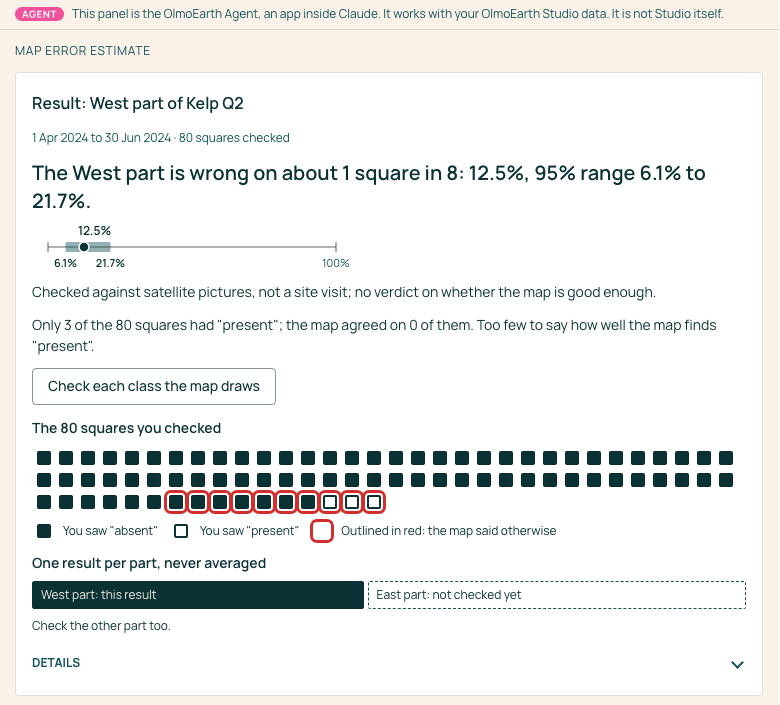
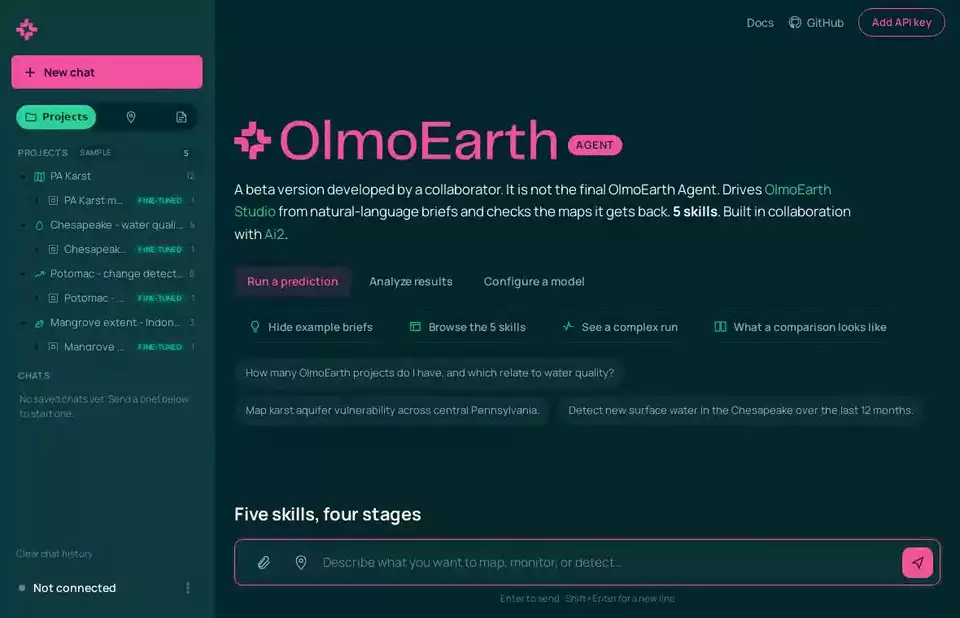

<div align="center">

&nbsp;&nbsp;

A beta version developed by a collaborator. It is not the final OlmoEarth Agent.

</div>

Drives [OlmoEarth Studio](https://allenai.org/blog/olmoearth) from a request in plain words, and checks the maps it
gets back with the statistics of [olmoearth-inferencex](https://github.com/2imi9/olmoearth_inferenceX). Two ways to
use it:

- **[MCP App](#mcp-app)**: in Claude Desktop, with panels beside the chat. Claude answers.
- **[Agent app](#agent-app)**: the project's own agent, in a web page or a terminal. A local LLM answers, or a cloud
  LLM on your own API key.

## MCP App

<table>
<tr>
<td width="50%"></td>
<td width="50%"></td>
</tr>
<tr>
<td></td>
<td></td>
</tr>
</table>

<sub>Screenshots from the browser test, with made-up data.</sub>

The main job, **Check how wrong a map is**:

1. On the start card, press **Check how wrong a map is** and pick your map in the projects panel.
2. On the Check card, write your labelling rule and choose how many squares to check.
3. On the label sheet, look at each square's satellite pictures and pick what you see, or **Cannot tell**.
4. The result card says how often the map is wrong, with a 95% range, one result per part.

**Quick setup with an agent.** Paste this into Claude Code or another coding agent:

```text
Set up the OlmoEarth Agent MCP App on this computer: download
https://raw.githubusercontent.com/2imi9/OlmoEarth-Agent/main/docs/mcp-app-setup.md with curl, read all of it, then
follow it step by step, copying its commands and JSON exactly.
```

**Quick setup by hand.** Needs [uv](https://docs.astral.sh/uv/) and git. In Claude Desktop's config (Settings,
Developer, Edit Config), add the `olmoearth-agent` entry inside `mcpServers` and keep any other entries. `which uvx`
gives the path (Windows: `where.exe uvx`, each `\` written `\\`). Then quit Claude Desktop and open it again:

```json
{
  "mcpServers": {
    "olmoearth-agent": {
      "command": "/absolute/path/to/uvx",
      "args": ["--python", "3.12", "--from",
               "olmoearth-agent[mcp,inferencex] @ git+https://github.com/2imi9/OlmoEarth-Agent",
               "olmoearth-agent-mcp"]
    }
  }
}
```

Then ask Claude what the OlmoEarth Agent can do. On the card, press **Open the sign-in page** and paste your own
Studio API key; it never passes through Claude. No Studio account yet? **Request access** at
[olmoearth.allenai.org](https://olmoearth.allenai.org/).

Setup, limits and troubleshooting: [docs/mcp-app-setup.md](docs/mcp-app-setup.md). Every panel and what its words
mean: [docs/Usage.md](docs/Usage.md#in-claude-with-views-mcp-app).

## Agent app

<div align="center">

[](webui/demo/olmoearth-agent-demo.mp4)

<sub>Demo mode (35 s), replaying what `make verify-demo` recorded on a Dynamic World tile, with each check's figure; no
real Studio key and no LLM. Click for the MP4.</sub>

</div>

The project's own agent finds a model in Studio, runs and compares predictions, and
[checks a map](docs/Usage.md#what-it-checks). It checks each answer against the tool results before showing it.

Needs [uv](https://docs.astral.sh/uv/) and an OlmoEarth Studio API key (Studio, your profile, **API Keys**). The local
LLM (llama.cpp) also needs Docker and an NVIDIA GPU; a cloud API key (Claude, ChatGPT or Gemini) needs neither.

```bash
git clone https://github.com/2imi9/OlmoEarth-Agent.git && cd OlmoEarth-Agent
make setup      # uv sync --all-extras
```

- On a cloud API key: `make bridge` serves the live web UI on http://localhost:8088. In the status chip's menu (foot
  of the sidebar), pick the provider under **Agent settings -> Model backend** and paste its key.
- On the local LLM: `make up` starts it (the first run downloads the model), then the same web UI.

Open the page, paste your Studio key and ask in plain words. Both keys stay in your browser and go with each request;
the server does not store them.

From the terminal, on the local LLM:

```bash
export OLMOEARTH_API_KEY=...
make serve && make agent Q="How many OlmoEarth Studio projects do I have?"
```

`make help` lists the targets; without `make`, see the [quick start](docs/Usage.md#quick-start).

## More

- Every skill, tool, rule and setting: [docs/Usage.md](docs/Usage.md). Changes: [CHANGELOG.md](CHANGELOG.md).
- [Limits](docs/Limits.md), [a check on a real map](docs/VERIFICATION_DEMO.md),
  [answer checks](docs/Usage.md#answer-checks) and [Claude Code as the model](docs/Usage.md#claude-code-as-the-model).
- Development: `uv sync --all-extras`, `uv run pre-commit install` and `uv run pytest`. Sign off each commit
  (`git commit -s`, the DCO); see [development](docs/Usage.md#development).
- [OlmoEarth Artifact License](LICENSE) (Ai2): free use with restrictions: no military, defense, surveillance or
  extractive uses; cite Ai2 and pass the terms on downstream. It matches
  [allenai/olmoearth_pretrain](https://github.com/allenai/olmoearth_pretrain/blob/main/LICENSE).
- Built in collaboration with Ai2, on OlmoEarth Studio. A research demo, not an official product.
