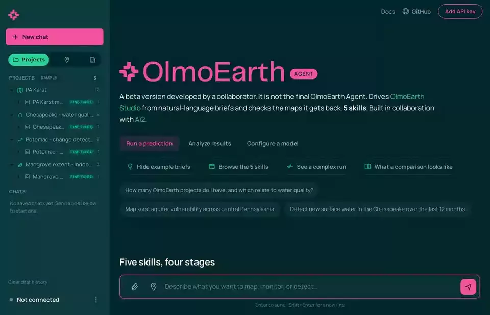

OlmoEarth Agent (beta)
======================

A beta version developed by a collaborator. It is not the final OlmoEarth Agent.

<div align="center">

[](webui/demo/olmoearth-agent-demo.mp4)

<sub>Demo mode (32 s), replaying what `make verify-demo` recorded on a Dynamic World tile; no real Studio key and no
LLM. Click for the MP4.</sub>

</div>

Drives [OlmoEarth Studio](https://allenai.org/blog/olmoearth) from a plain-language brief, and checks the maps it gets
back.

- It finds a model in Studio, runs predictions and compares their results.
- It checks a map: which windows to review first, how wrong the map is, which part you can trust, and which of two
  maps of one time is more accurate. The statistics come from
  [olmoearth-inferencex](https://github.com/2imi9/olmoearth_inferenceX).
- It checks each answer against the tool results before showing it.
- It runs on a local LLM (llama.cpp) or on your own cloud API key (Claude, ChatGPT or Gemini).


Install
-------

Needs [uv](https://docs.astral.sh/uv/) and an OlmoEarth Studio API key (Studio, your profile, **API Keys**). The local
LLM also needs Docker and an NVIDIA GPU; a cloud API key needs neither.

```bash
git clone https://github.com/2imi9/OlmoEarth-Agent.git && cd OlmoEarth-Agent
make setup      # uv sync --all-extras
```

- On a cloud API key: `make bridge` serves the live web UI on http://localhost:8088. In the status chip's menu (foot
  of the sidebar), pick the provider under **Agent settings -> Model backend** and paste its key.
- On the local LLM: `make up` starts it (the first run downloads the model), then the same web UI.

Open the page, paste your Studio key and send a brief. Both keys stay in your browser and go with each request; the
server does not store them.

From the terminal, on the local LLM:

```bash
export OLMOEARTH_API_KEY=...
make serve && make agent Q="How many OlmoEarth Studio projects do I have?"
```

- `make help` lists the targets; `make down` stops the local LLM; `make web` serves a demo UI with sample data on
  port 8080.
- A read-only Studio key: set `OLMOEARTH_READ_ONLY=1`. The two tools that write to Studio are then left out.
- Without `make`, run what the targets run ([quick start](docs/Usage.md#quick-start)).


What it answers
---------------

Ask in plain words; the agent picks the tools. The main questions:

- **Which windows do I check first?** `olmoearth_review_set`, or `olmoearth_review_set_from_result` for a Studio
  result, with no labels.
- **How wrong is the map?** `olmoearth_plan_label_sample`, label the windows it draws, then
  `olmoearth_estimate_map_error`.
- **Which part can I trust?** `olmoearth_certify_zone`, on the labels of a random sample.
- **Which of two maps of one time is more accurate?** `olmoearth_plan_label_sample` with `design='disagreement'`,
  label where they differ, then `olmoearth_estimate_map_error`.
- **How do my Studio results differ?** `olmoearth_compare_results`: a pair, a group, a series over dates, or an
  ensemble's disagreement, with no ground truth.

<details>
<summary>Every route, with the labels each needs</summary>

| Question | Tools | Labels |
|---|---|---|
| Which windows to check first | `olmoearth_review_set`, `olmoearth_review_set_from_result` | none |
| How wrong one map is | `olmoearth_plan_label_sample`, then `olmoearth_estimate_map_error` | a planned sample |
| Which part to trust | `olmoearth_certify_zone` | a random sample |
| A Studio class map without top-k scores | `olmoearth_plan_label_sample` (`design='random'` or `'class'`), then `olmoearth_estimate_map_error` | a random or class sample |
| A Studio result's own files | `olmoearth_scores_from_studio` | none |
| A direct run's certificate | `olmoearth_scores_from_file`, `olmoearth_write_certificate`, `olmoearth_verify_certificate` | a `seed_from_map` random sample |
| Which of two maps is more accurate | `olmoearth_plan_label_sample` (`design='disagreement'`), then `olmoearth_estimate_map_error` | where they differ |
| What labels Studio holds | `olmoearth_studio_label_inventory` | none |
| How Studio results differ | `olmoearth_compare_results` | none |

What each needs and gives: [What it checks](docs/Usage.md#what-it-checks).

</details>

- The agent registers 25 tools by default, in 5 skills: configure a Studio job, run and compare predictions, record
  provenance, write a stakeholder report and check a map. All 25 are sent on every turn. See
  [Skills](docs/Usage.md#skills) and [Tools](docs/Usage.md#tools).
- The label plans, error estimates, certified zones, certificates and the readers of a run's or a Studio result's files
  need the `inferencex` extra (olmoearth-inferencex 1.20.3 or later, Python 3.11 to 3.13); the review set does not.
  `make setup` installs it.


Use from Claude Code
--------------------

A Claude Code session can play the agent's model through the replay bridge, `olmoearth-agent-bridge` (not
`make bridge`, which serves the web UI). Each command is one model call: `begin` starts a run from a brief and `step`
answers the pending call, while the agent's own loop, tools and checks run unchanged. Each response is kept with the
sha256 of the request it answered, so a replay that diverges stops. The project skills `olmoearth-agent-model` and
`olmoearth-agent-bridge` ([.claude/skills](.claude/skills)) say how; details in
[Claude Code as the model](docs/Usage.md#claude-code-as-the-model).


Answer checks
-------------

Every tool call goes into a provenance manifest, and tool arguments are checked against each tool's schema. Before an
answer is shown, the harness checks:

- its numbers, against the tool results and your messages;
- its directions, places and magnitudes, against the facts the tools computed;
- its claims of files saved or items listed, against what the run did;
- the claims the tools forbid or require.

One request asks the model to fix every problem found; a sentence that still fails is marked `[unverified: <check>]`.
`OLMOEARTH_CHECK_NUMBERS=0` turns off the number check and `OLMOEARTH_CHECK_ANSWER=0` the rest. With
`OLMOEARTH_CHECK_CLAIMS=1`, the model also reads the answer against the run's record. The stakeholder report states
only the accuracy the verification tools measured in the same request, or says none was. Details:
[answer checks](docs/Usage.md#answer-checks).


Example
-------

`make verify-demo` runs the verification tools on the expert-annotated Dynamic World tile that olmoearth-inferencex
ships (southern Peru, 9 June 2019), with no Studio key and no LLM. It writes
[docs/VERIFICATION_DEMO.md](docs/VERIFICATION_DEMO.md).

- **The map.** 15,813 expert-annotated 40 m windows; 19.3% are wrong (not Dynamic World's 10 m accuracy). The tools
  saw only the labels their plans drew.
- **The estimates.** 300 random labels give 19.0% (14.8% to 23.9%); 360 class-design labels give 17.4% (valid
  interval 11.8% to 25.2%).
- **The review set.** The 791 windows (5%) it flags first, with no labels, are wrong 67% of the time (532 of 791); a
  random 5% would be wrong 19% of the time.
- **No certificate.** No zone was certified at alpha 0.1 with 300 labels, so none was written.


Limits
------

- Without labels it tells you where to look, not how wrong the map is. A review set is not a sample.
- A Studio result is read on a grid of sampled points (at most 16 x 16), so its figures cover those points, not every
  pixel. For a map with scores, `olmoearth_scores_from_studio` reads its own files and covers every valid window.
- Comparing results uses no ground truth: a series estimates movement, not verified change on the ground.
- A certificate adds no guarantee: its labels, the map's date and the single draw are the issuer's word.
- Intervals and certified zones assume the labels are right.
- The egress allowlist only logs by default; beyond your own machine, set `OLMOEARTH_EGRESS=enforce`. It does not
  cover the olmoearth-inferencex command line the agent starts ([security](docs/Usage.md#security)).


More
----

- Every skill, tool, rule and setting: [docs/Usage.md](docs/Usage.md). Changes: [CHANGELOG.md](CHANGELOG.md).
- Development: `uv sync --all-extras`, `uv run pre-commit install` and `uv run pytest`. Sign off each commit
  (`git commit -s`, the DCO); see [development](docs/Usage.md#development).
- [OlmoEarth Artifact License](LICENSE) (Ai2): free use with restrictions: no military, defense, surveillance or
  extractive uses; cite Ai2 and pass the terms on downstream. It matches
  [allenai/olmoearth_pretrain](https://github.com/allenai/olmoearth_pretrain/blob/main/LICENSE).
- Built in collaboration with Ai2, on OlmoEarth Studio. A research demo, not an official product.
