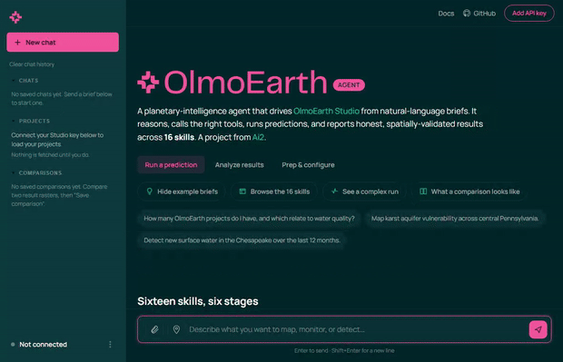

<div align="center">

&nbsp;&nbsp;

**Drive [OlmoEarth Studio](https://allenai.org/blog/olmoearth) from natural-language briefs - on a local LLM, or your own cloud API.**

[](LICENSE)
[](SKILLS.md)
[](https://huggingface.co/unsloth/Qwen3.6-35B-A3B-GGUF)
[](pyproject.toml)

</div>

- It drives OlmoEarth Studio from a plain-language brief: it finds a model, runs predictions and compares results.
- It checks a map: which windows to review first (maps with scores only), and how wrong the map is, with the interval its labels earn.
- It tests which of two maps of one time is more accurate, and packs a direct OlmoEarth run's certified zone into a certificate anyone with the map can check.
- It checks each answer against the tool results before showing it.
- It runs on a local Qwen3.6 model, or on your own cloud API key (Claude, ChatGPT or Gemini).
- Its verification statistics (error rates and their intervals, the two-map test, certified zones and certificates) come from [olmoearth-inferencex](https://github.com/2imi9/olmoearth_inferenceX), the `inferencex` extra.

<div align="center">



</div>

<div align="center"><sub>Connect a Studio key and send a brief: the agent streams its reasoning, tool calls, results and a plain-English answer in a multi-turn chat. Draw an area of interest on a map in the chat, and it is stored as a Studio area. &nbsp; | &nbsp; <a href="webui/demo/olmoearth-agent-demo.mp4">walkthrough (MP4)</a></sub></div>

<div align="center"><sub>Demo recorded on <a href="https://github.com/2imi9/OlmoEarth-Agent/releases/tag/v1.2.0">v1.2.0</a>.</sub></div>

---

## What it checks

| Route | Needs | Gives |
|---|---|---|
| **Which windows to check first**<br>`olmoearth_review_set`, `olmoearth_review_set_from_result` | A map with scores: a Studio `[0, 1]` score band (another regression band needs a `threshold`), a direct run's scores, or your own. No labels. | The windows to open first at your review budget, least confident first. Boundary-first is optional. |
| **How wrong one map is**<br>`olmoearth_plan_label_sample`, then `olmoearth_estimate_map_error` / `olmoearth_certify_zone` | A map with scores and labels on a planned sample. A Studio result is sampled on at most 16 x 16 points (256 windows), so its figures cover those points, not every pixel. | The error rate: the interval valid at every sample size first, then the design's (approximate under the default confidence design, exact under a random one). Per-class accuracy where labels name the class, each class's valid interval first, its producer's accuracy beside its user's, and whether the map draws it too little or too much. A random design can certify a zone. |
| **A Studio class map**<br>`olmoearth_plan_label_sample` (`design='random'` or `'class'`), then `olmoearth_estimate_map_error` | A classification result (classes, no scores) and labels on a random or class-stratified sample. The plan gives olmoearth-inferencex's label budget for a random sample. | The error rate and per-class accuracy, the interval valid at every sample size first. They cover the sampled grid points (at most 16 x 16, one pixel each), not every pixel. No review set, no certified zone. |
| **A direct OlmoEarth run and its certificate**<br>`olmoearth_scores_from_file`, `olmoearth_write_certificate`, `olmoearth_verify_certificate` | `oe-inferencex from-olmoearth`'s `scores_<EPSG>.tif` and `olmoearth_output.json`, or `score_area.py`'s raster and `manifest.json`, with probabilities or logits (class ids are refused). A certificate needs a `seed_from_map` random plan; its labels are fixed once first graded. | Every window of the run, for the review set, estimate and two-map route. Its certified zone in a certificate anyone with the map can recheck; its labels, the map's date and single draw are the issuer's word. It adds no guarantee. |
| **Which of two maps is more accurate**<br>`olmoearth_plan_label_sample` (`design='disagreement'`; `date_a` / `date_b` date a scores file), then `olmoearth_estimate_map_error` | Two maps of one area and time: two Studio results, or two scores files of one window grid (not class-map rasters). Labels where they differ; the plan advises how many. Different, overlapping or one-sided dates are refused when given; missing dates are noted. Maps of different times are measured each on its own sample. | Which map is more accurate, or neither (exact sign test; the interval past a fifth of the differing windows), and the accuracy difference with a 95% interval. Studio results cover at most 12 x 12 sampled points, not every pixel. |

See it on a real map: `make verify-demo` runs the verification tools on the expert-annotated Dynamic World tile that olmoearth-inferencex ships. It needs the `inferencex` extra (`make setup`, Python 3.11 to 3.13), no Studio key and no LLM. [docs/VERIFICATION_DEMO.md](docs/VERIFICATION_DEMO.md) shows each result:

- **The map.** 15,813 expert-annotated 40 m windows of one tile (southern Peru, 2019-06-09). Their true error rate is 19.3%, from every window's expert label, which a user does not have. It is not Dynamic World's 10 m accuracy.
- **The estimates.** 300 random labels give 19.0%, interval 14.8% to 23.9%. 360 class-design labels give 17.4%, valid interval 11.8% to 25.2%. Each interval the page checks covers 19.3%. That is one draw, not evidence of how often such intervals cover the truth.
- **The review set.** At a 5% budget it lists 791 windows to check first. Against every window's expert label (the script's check, not the tool's), they hold 17.5% of the errors; the attainable ceiling is 26.0%.
- **No certificate on this tile.** No zone was certified at alpha 0.1 with 300 labels, so no certificate was written. The certificate round trip and a tampered copy are tested on a synthetic tile, not on this map.

## Quick start

> **Prerequisites:** [uv](https://docs.astral.sh/uv/) and an OlmoEarth Studio API key (Studio UI -> profile -> **API Keys**). The **local model** path also needs [Docker](https://docs.docker.com/get-docker/). The **cloud-API** path needs neither Docker nor a download.

Pick the LLM behind the agent. Both drive the same live UI.

**A. Cloud API** (Claude / ChatGPT / Gemini) - no Docker, no 17.7 GB download:

```bash
make setup      # uv sync --all-extras
make bridge     # live web UI on http://localhost:8088 (no local model needed)
```

Open **http://localhost:8088** and paste your Studio key. In **Settings -> LLM backend**, pick a provider and paste its API key. Both keys stay client-side, are sent per request and are never stored server-side. Send a brief.

**B. Local model** (fully offline, free) - one command starts the LLM and the UI:

```bash
make setup      # uv sync --all-extras
make up         # start the 4-bit Qwen3.6 LLM (first run pulls ~17.7 GB), then the live UI
```

Open **http://localhost:8088**, paste your Studio key, and send a brief. `make up` is `make serve` then `make bridge`; you can run them separately.

**Prefer the terminal?** Run a one-shot brief against the local model:

```bash
export OLMOEARTH_API_KEY=...   # Studio UI -> profile -> API Keys
make serve && make agent       # make agent runs a sample brief; ask your own with Q="..."
```

- `make help` lists every target; `make down` stops the LLM.
- `make web` serves a backend-free **demo** UI on `:8080`.
- `LLM_ENDPOINT` defaults to `http://localhost:8000/v1`.
- No `make` (e.g. Windows + Git Bash)? [`./scripts/quickstart.sh`](scripts/quickstart.sh) runs setup + serve and prints the exact `uv run` commands.
- [`docs/serving.md`](docs/serving.md) has the cloud-API setup and the raw `docker compose` invocations.

## What it does

- **The loop.** The LLM reads the brief and calls a tool. The harness runs it, feeds the result back, and repeats until the model can answer. Every tool call goes into a provenance manifest. An opt-in `system:python` subprocess (`OLMOEARTH_RUN_PYTHON=1`) handles light glue between calls.
- **Soul and capability card.** The persona and guardrails live in a versioned soul file (`harness/soul.md`; swap it with `OLMOEARTH_SOUL_PATH`). The system prompt adds a capability card built from the tools' code: what each tool does, needs and cannot do, and what no tool can do (`harness/capabilities.py`).
- **Checked arguments.** Tool arguments are schema-validated at dispatch.
- **Result spill.** Oversized tool results go to workspace files, not the context window.
- **Answer checks** (`harness/checks.py`). Before an answer is shown, the harness checks:
  - its numbers, against the tool results and the user's messages;
  - its directions, places and magnitudes, against the facts the tools computed;
  - its claims of files saved or items listed, against what the run did;
  - the claims the tools forbid or require.
- **Rewrite and marking.** One request asks the model to fix every problem found. A sentence that still fails is marked `[unverified: <check>]`. `OLMOEARTH_CHECK_NUMBERS=0` turns off the number check; `OLMOEARTH_CHECK_ANSWER=0` turns off the rest.
- **Claim check (opt-in).** With `OLMOEARTH_CHECK_CLAIMS=1`, the agent's own model also reads the answer against the run's record. It flags statements no tool output supports and offers no tool can carry out, in the same rewrite and marking (`harness/claim_check.py`).
- **Memory.** Durable user preferences (default project, area, sources), saved with `olmoearth_remember`, carry across conversations.

> **Production posture:** the per-capability egress allowlist defaults to `audit` (log only), so a first run never breaks. Beyond your own laptop, set `OLMOEARTH_EGRESS=enforce`: unknown hosts are then refused, not just logged. It checks the hosts the agent's own code calls; the opt-in `system:python` subprocess is not network-isolated, so `enforce` does not cover it. Add self-hosted endpoints with `OLMOEARTH_EGRESS_ALLOW`.

The capability set ships as **18 skills**, grouped by EO-workflow stage. Four of them (#1-#3 and #17) are instruction packages (`SKILL.md`) inside the Python package; `olmoearth_load_skill` loads them on demand.

- The agent registers 28 tools by default: the Studio run loop, comparison, verification and plumbing (provenance, export, QGIS, memory). All 28 are sent on every turn.
- Another 15 opt-in tools stay off. They train models outside Studio, need inputs no Studio run produces, repeat Ai2's Explorer, cost a core slot every turn (literature search), or name a winner with no test.
- Skills #6, #8, #10, #15 and #16 are opt-in whole, as is #18's rule grader. [`SKILLS.md`](SKILLS.md#opt-in-tools) gives each tool's reason and what the "/" menu does without the setting.

```bash
OLMOEARTH_OPT_IN_TOOLS=1 make bridge   # registers the opt-in tools; the same setting works for make agent
```

<details>
<summary><strong>The 18 skills</strong>, by workflow stage (Prep / Configure / Run / Analyze / Integrate / Report); <em>opt-in</em> marks what needs <code>OLMOEARTH_OPT_IN_TOOLS=1</code></summary>

| # | Skill | What it does | Stage |
|---|---|---|---|
| 1 | `olmoearth-data-prep` | Labels (GeoJSON/CSV/Shapefile) -> Studio-importable file (MIME / 10K / multi-metric guards) AND `rslearn` `dataset.json` + Lightning YAML, with a 7-criteria audit | **Prep** |
| 2 | `olmoearth-studio-job-config` | Task description -> Studio wizard answers, 14 presets + cross-field validator | **Configure** |
| 3 | `olmoearth-embeddings` | Embeddings-vs-fine-tune **guidance + a runnable notebook**; Ai2's precomputed [OlmoEarth v1.3 embeddings](https://source.coop/olmoearth/olmoearth-v1-3-embeddings) (one vector per 10 m pixel per year) replace computing them yourself for an annual task in an area and year they cover. The **one-call** `olmoearth_automate` (decide + propose a config; optional HuggingFace introspection) is *opt-in* | **Configure** |
| 4 | `olmoearth-predict` | Core run primitive: submit / poll / fetch results, sample the output at a point, compare results with no ground truth | **Run** |
| 5 | `olmoearth-change-detection` | Change over time: one model's dated Studio results traced as a series (`olmoearth_compare_results`, mode `series`: date-ordered, legend-calibrated shifts; estimate movement, not verified ground change). The trajectory of your own dated values (`olmoearth_change_detect`, refuses fewer than 3 dates) is *opt-in* | **Run** |
| 6 | `olmoearth-baseline-compare` | *Opt-in.* Studio vs. a baseline foundation model, side-by-side on transfer regions; its winner is a point metric with no test, so which map is more accurate is #18's two-map route (both maps as Studio results, or as scores files of one window grid) | **Run** |
| 7 | `olmoearth-evaluate` | Per-class accuracy against your labels; spatial-block CV and NNDM-LOO are *opt-in* | **Analyze** |
| 8 | `olmoearth-similarity` | *Opt-in.* Exact top-K kNN over supplied embeddings (e.g. OlmoEarth Base) | **Analyze** |
| 9 | `olmoearth-uncertainty` | Ensemble-disagreement confidence across Studio results; the Meyer-Pebesma Area-of-Applicability (OOD) flag is *opt-in* | **Analyze** |
| 10 | `olmoearth-cloud-mask-audit` | *Opt-in.* CFMask / s2cloudless / Sen2Cor / MAJA ensemble disagreement | **Analyze** |
| 11 | `olmoearth-qgis-bridge` | Tile URLs -> a QGIS `.qlr` layer + GDAL_WMS descriptor + XYZ URLs + SLD ramp + legend + a local `gdal_translate` COG recipe (key never embedded) | **Integrate** |
| 12 | `olmoearth-data-export` | Export Studio projects + predictions to JSON, grouped by project or status | **Integrate** |
| 13 | `olmoearth-provenance` | Manifest wrapper around every API call; emits a replay script | **Report** |
| 14 | `olmoearth-case-narrative` | Stakeholder writeup with live tiles + a freshness gate. It states the accuracy the verification tools (#18) measured in the same request, as they returned it: estimate, intervals, labels, design, seed. If none was measured, it says so. An accuracy figure the model typed is refused | **Report** |
| 15 | `olmoearth-litsearch` | *Opt-in.* arXiv + OpenAlex literature search + DOI/arXiv-id resolution to ground citations; optional [Asta](https://github.com/allenai/asta-plugins) full-text ranked search when its CLI is installed; a paper Asta marks not legal to show comes back with its metadata, not its text | **Report** |
| 16 | `olmoearth-negative-sampler` | *Opt-in.* Presence-only labels -> trainable set: generates a buffered, spatially-thinned (optionally embedding-dissimilar) negative class so the data-prep audit passes | **Prep** |
| 17 | `olmoearth-rslearn` | Guidance for running rslearn (the data + training engine under OlmoEarth): the 4-stage pipeline and fit/predict, as commands for you to run. The torch-free tools to **recommend** a full setup from a plain-language goal and **validate** a config (shapes / label-type / bands) before a multi-hour run are *opt-in* | **Configure** |
| 18 | `olmoearth-review-set` | **Which windows to check first, without labels.** Ranks windows by the model's own top-1-minus-top-2 margin at your review budget (boundary-first optional), reports the attainable ceiling `min(1, budget/error_rate)` so a capture is read against what was reachable, and (*opt-in*) grades any candidate audit rule against the margin and a no-model control with a per-group sign test. Bring-your-own scores: Studio returns hard classes only. Which of two class maps of one time is more accurate needs no scores: labels on a random sample of the windows where they differ (`design='disagreement'`). A direct model run's files (`score_area.py`'s or `from-olmoearth`'s), the label-sample plan, the error estimate, the certified zone and its certificate, the two-map route and `olmoearth_compare_review`'s reading of dates need the `inferencex` extra (`pip install 'olmoearth-agent[inferencex]'`, olmoearth-inferencex 1.20.1 or later, Python 3.11 to 3.13; `make setup` installs it there) | **Analyze** |

</details>

[**`docs/SHOWCASE.md`**](docs/SHOWCASE.md) has captured runs of skills #1-#16 with real outputs, driven by the live Qwen3.6 backbone. They were captured with an earlier tool set; some call tools that are now opt-in ([`SKILLS.md`](SKILLS.md#opt-in-tools)). Per-skill specs are in [`SKILLS.md`](SKILLS.md); the function catalog, harness dataclasses and operational rules are in [`PLAN.md`](PLAN.md).

## Stack

<details>
<summary><strong>The stack</strong>, layer by layer</summary>

| Layer | What |
|---|---|
| **LLM** | **Default:** [Qwen3.6-35B-A3B](https://huggingface.co/Qwen/Qwen3.6-35B-A3B) (35B total / 3B active, hybrid Gated-DeltaNet + MoE), served locally as a 4-bit GGUF ([`unsloth/Qwen3.6-35B-A3B-GGUF`](https://huggingface.co/unsloth/Qwen3.6-35B-A3B-GGUF) `UD-IQ4_XS`, ~17.7 GB). **Optional:** bring your own **cloud API** key, selected in the web UI (model autodetect; key never stored) |
| **Serving** | [llama.cpp](https://github.com/ggml-org/llama.cpp) (`ghcr.io/ggml-org/llama.cpp:server-cuda`), OpenAI-compatible API, `--jinja` for tool calling: see [`docs/serving.md`](docs/serving.md) |
| **Harness** | A catalog of function-call tools (more behind `OLMOEARTH_OPT_IN_TOOLS=1`), an **opt-in** `system:python` subprocess for light glue (`OLMOEARTH_RUN_PYTHON=1`), and a provenance manifest per call ([`PLAN.md`](PLAN.md)) |
| **Skills** | 18-skill catalog ([`SKILLS.md`](SKILLS.md)); the instruction packages for #1-#3 and #17 are in [`src/olmoearth_agent/skills/packages/`](src/olmoearth_agent/skills/packages/) |
| **Studio API** | `https://olmoearth.allenai.org/api/v1`, Bearer `OLMOEARTH_API_KEY` ([docs](https://docs.olmoearth.allenai.org/)) |

</details>

## Docs & links

- [**PLAN.md**](PLAN.md): the function catalog, harness dataclasses, and operational rules
- [**SKILLS.md**](SKILLS.md): the 18-skill catalog (Prep / Configure / Run / Analyze / Integrate / Report)
- [**docs/VERIFICATION_DEMO.md**](docs/VERIFICATION_DEMO.md): the verification tools on a real map, written by `make verify-demo`
- [**docs/SHOWCASE.md**](docs/SHOWCASE.md): captured runs of skills #1-#16
- [**docs/CANON.md**](docs/CANON.md): the canonical facts the repo holds itself to
- [**CONTRIBUTING.md**](CONTRIBUTING.md) | [**CHANGELOG.md**](CHANGELOG.md) | [**AGENTS.md**](AGENTS.md)

## License

[OlmoEarth Artifact License](LICENSE) (Ai2) - free use with restrictions: no military/defense/surveillance or extractive uses; cite Ai2 and propagate the terms downstream. Matches [`allenai/olmoearth_pretrain`](https://github.com/allenai/olmoearth_pretrain/blob/main/LICENSE).

<div align="center"><sub>Built in collaboration with Ai2, on OlmoEarth Studio. A research demo, not an official product.</sub></div>
