# The MCP App, panel by panel

The MCP App is the OlmoEarth Agent inside Claude Desktop: panels beside the chat that check how wrong a Studio map
is. Setup: [mcp-app-setup.md](mcp-app-setup.md). The words on the panels: [terms.md](terms.md).

In the main job you meet the panels in this order: start card, projects panel, Check card, label sheet, result card.
The screenshots use made-up data.

## Start card

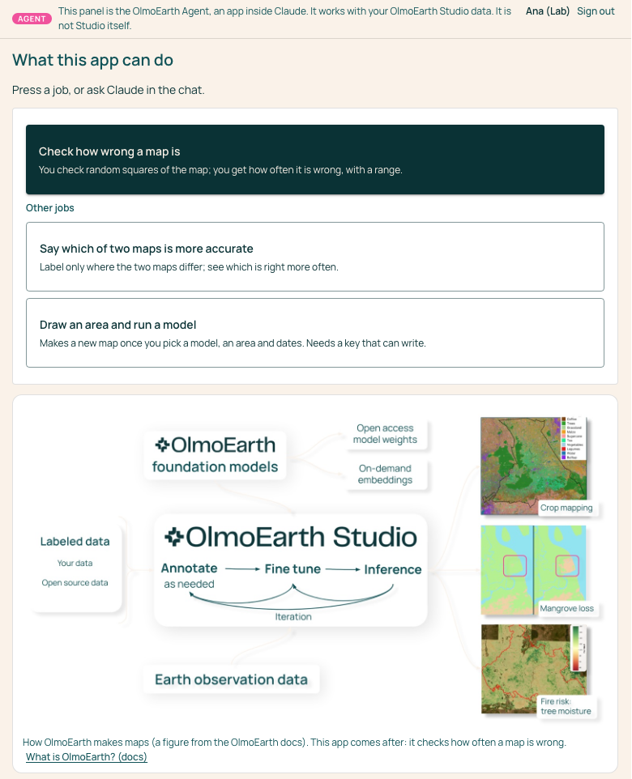

**What you see.** "What this app can do" and one box per job: **Check how wrong a map is** first, then, under "Other
jobs", **Say which of two maps is more accurate** and **Draw an area and run a model**. The top line names your
Studio account and has **Sign out**. If the app was installed with its own key, the line reads "Signed in with the
app's own key" and has no Sign out. A figure shows how OlmoEarth makes maps; this app comes after that. With Asta
turned on in [Settings](#settings), one more box stands last under "Other jobs": **Search papers with Asta**.

**What to press.** Press a job, or ask Claude in the chat. A job's press sends its request to Claude as your message,
and Claude shows your projects, where you pick the map or model. While you are signed out the jobs are off and the
card shows the sign-in. **Search papers with Asta** works signed in or out: Claude asks what to search first.
One job at a time: once a job's message is in the chat, the job boxes turn off. If the message waits in Claude's
message box, press Send. To start another job, ask Claude.

**What it means.** The main job checks a random sample of a map's squares and tells you how often the map is wrong.
The other jobs compare two maps, or make a new map, which needs a Studio key that can write.

**When it fails.** If the card cannot start, or no card shows, see
[When a card stops or fails](#when-a-card-stops-or-fails).

## Sign in

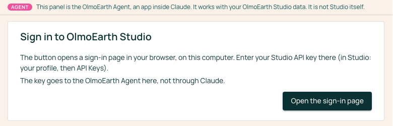

**What you see.** "Sign in to OlmoEarth Studio", what the button opens, where the key goes, and **Open the sign-in
page**. Every card that needs Studio shows this box while you are signed out. The start card shows it too, with its
own note: the key must be your own, and **Request access** if you have no Studio account.

**What to press.** Press **Open the sign-in page**. A page that the app serves on this computer opens in your
browser. Paste your Studio API key (in Studio: your profile, then API Keys) and press **Sign in**. Leave **Remember
on this computer** ticked to keep the key in a file only you can read; untick it to sign in for this run only.

**What it means.** The key goes from your browser to the app, never through Claude. A read-only key can check maps;
saving an area or running a model needs a key that can write. No Studio account yet? Press **Request access** on the
start card.

**When it fails.** The page says why it refused a key, or that Studio could not be reached; nothing is saved then.
The page works for 10 minutes; if it closes first, the card says "The sign-in page has closed. Open it again to sign
in." If no browser opens, the card shows the address to open.

## Projects panel

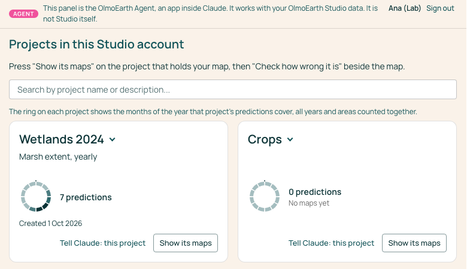

**What you see.** "Projects in this Studio account": a search box and one card per project, with a ring of the
months its predictions cover, **Show its maps** and **Tell Claude: this project**. When you have label sheets on this
computer that are part done, "In progress" lists them above the search, each with **Resume**.

**What to press.** Press **Show its maps** on the project that holds your map, then **Check how wrong it is** beside
the map. To compare, tick two finished maps of the same area and dates in one project and press **Which is more
accurate?**. To make a map, open **Make a new map** and press **Run on an area** on a model. One job at a time
here too: once a job's message is in the chat, the job buttons turn off; to start another, ask Claude.

**What it means.** Each prediction is a model run over an area and a period; its output is the map. A run that made
more than one map opens its list; Studio names them only by ids, so ask whoever made the run which is yours. A line
under a row says when Check cannot run on it (a map of detections, or embeddings), or that its Check card will tell (a
map of numbers, or one whose kind is not recorded). **Tell Claude: this project** only says which project you mean;
it starts no job.

**When it fails.** A failed run says "This run failed in Studio. There is no map to check."

## Check card

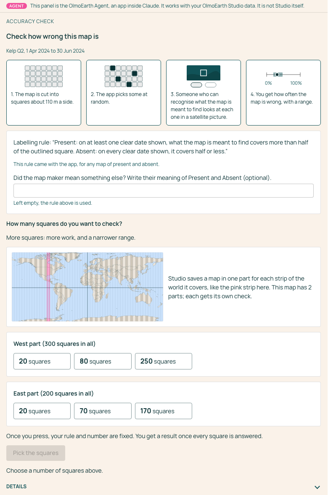

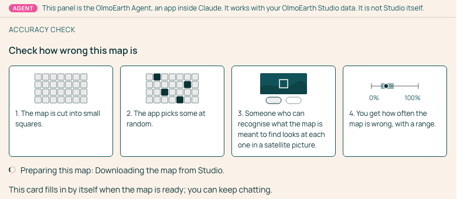

**What you see.** "Check how wrong this map is", the map's name and dates, four small pictures of the check, the
labelling rule, and "How many squares do you want to check?". A map saved in several parts shows one row of numbers
per part. A large map first shows "Preparing this map" (second picture); the card fills in by itself, and you can
keep chatting.

**What to press.** If the card asks for a rule, write one sentence of at least 10 characters on how you decide what
a square is. If it shows the rule that came with the app, keep it, or write the map maker's meaning of Present and
Absent in the box. Choose a number of squares for each part you want checked, then press **Pick the squares**: the
first part's label sheet opens in the card.

**What it means.** The app picks that many squares at random, once; your rule and number are fixed when you press.
More squares mean more work and a narrower range. Each part gets its own check and its own result. A part picked
before keeps its squares: pressing again opens the same ones.

**When it fails.** "The check could not start" keeps anything picked or saved before; ask Claude what to do next,
since it has the reason. Some maps of classes cannot be cut into squares (Studio kept only the classes). The card
then says so and offers **Check this map on points**. Points have no pictures, so you answer from your own imagery or
records. On a map of numbers that is not a score from 0 to 1, tell Claude the value from which a pixel counts as a
yes. The check then asks about single points, without pictures. "Preparing this map took too long" asks you to have
Claude open the Check card again.

## Label sheet

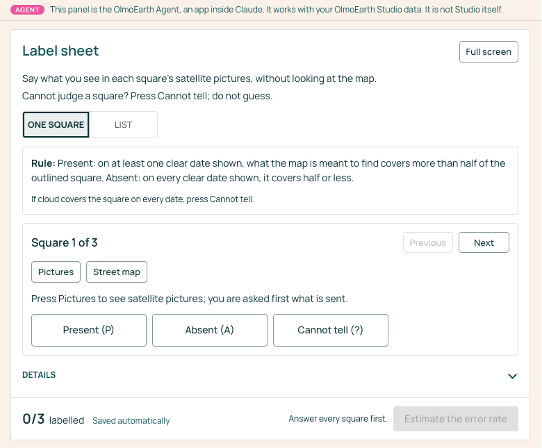

**What you see.** One square at a time ("Square 1 of 3"), the rule, and the answers as buttons with their keys:
Present (P), Absent (A), Cannot tell (?). On a map of classes the answers are the map's class names. **Pictures**
shows the square outlined on satellite pictures, one date for each month of the map's period; **Street map** opens
its place on OpenStreetMap. **List** shows every square as a row.

**What to press.** Press **Pictures**; the first time, the app asks before it sends anything (the box around the map,
rounded out, and its months, to the public Earth Search catalogue). Look at the outlined square and press what you
see, or **Cannot tell**; the next square without an answer shows, and the left and right arrow keys move between
squares. When every square is answered, press **Estimate the error rate**.

**What it means.** You label blind: the sheet does not show what the map says at a square, and the app works out
right or wrong. Do not guess: a Cannot tell widens the range, a guess can make the result wrong. Answers are saved
as you go ("Saved automatically"), so you can stop and come back. Once the sheet gives its result, its answers are
locked.

**When it fails.** "The pictures did not arrive" has **Try again**. "No satellite image was found for this square"
asks you to press **Cannot tell**. If the sheet was changed somewhere else, it says so, and how many of your answers
were not saved. Press **Reopen the sheet**, then answer those squares again.

## Result card

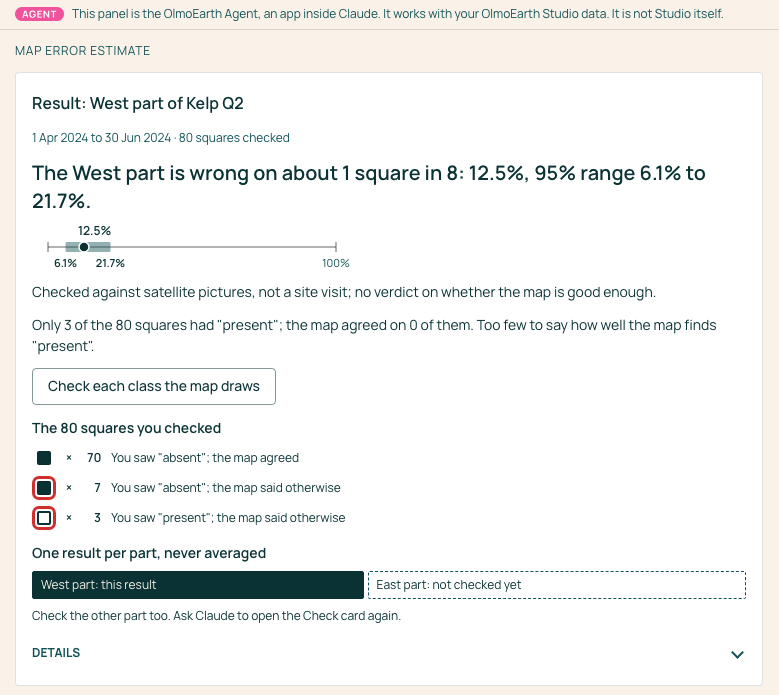

**What you see.** The part and map checked, the dates and the number of squares, then one sentence: how often the
map is wrong, in words and as a percent, with its 95% range. The line under it draws the rate as a dot and the range
as a band. Then the squares you checked, counted by kind (a red edge: the map said otherwise), and on a map in parts
one box per part.

**What to press.** Nothing more is needed. **Check each class the map draws** asks Claude for a second, separate
check, picked class by class. To check another part, ask Claude to open the Check card again. **Details** holds the
rule you used and the numbers behind the card.

**What it means.** The rate holds for that part only, checked against satellite pictures, not a site visit; the
card gives no verdict on whether the map is good enough. With Cannot tell answers the sentence gives two rates: if
each Cannot tell were right, or if each were wrong. Report each part with its own range, side by side; never average
them.

**When it fails.** "Not finished yet" means some squares have no answer: answer them on the sheet and press its
button again. "This result is out of date" means the sheet's answers changed after its first result, which showed
where the map disagreed. Answers changed after that are no longer blind, so this result does not count. A new result
needs another person and a fresh sheet; ask Claude for one.

## Plan card

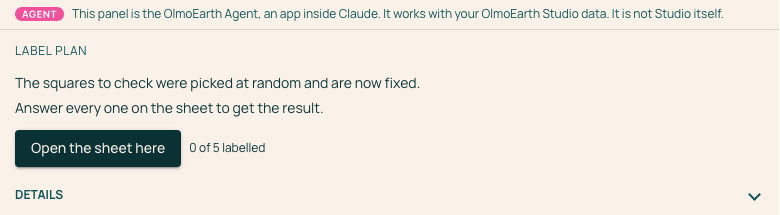

**What you see.** "Label plan", "The squares to check were picked at random and are now fixed.", **Open the sheet
here** and how many are labelled. It shows when Claude plans a sample itself: to compare two maps, to check a map on
points, or to check each class the map draws. A sheet of points says points.

**What to press.** Press **Open the sheet here**; the sheet opens in the card. Part way, the button reads **Continue
labelling**, and **Open the sheet** once every one is answered. Answer each square, then press the sheet's finish
button.

**What it means.** The pick is fixed, as on the Check card. The plan's figure shades the map by its confidence (how
sure the model was). Seeing that could sway your answers, so it shows only once the whole sheet is labelled. Details
names the sheet's file on this computer; the file shows the map's class, so answer in the panel, not in the file.

**When it fails.** If the counts cannot be read, the button keeps "Open the sheet here" and shows no count. If the
sheet does not open, a line at the foot of the card says why; ask Claude to open the label sheet again.

## Which of two maps is more accurate

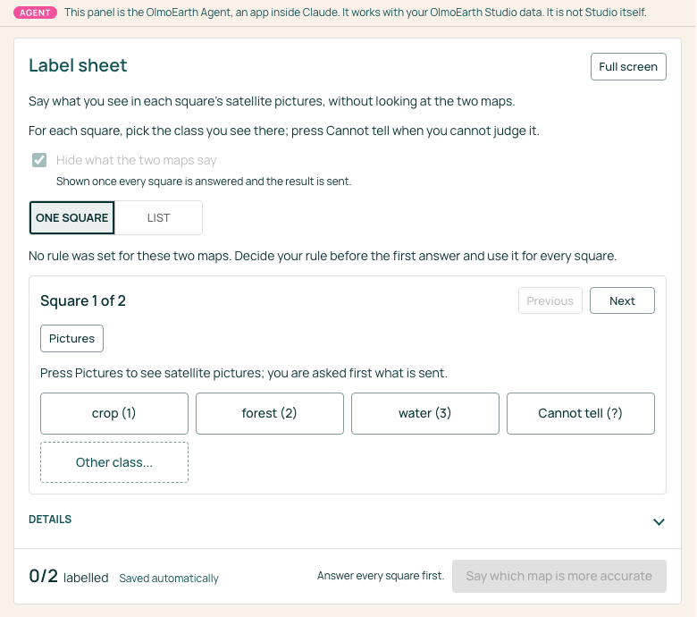

The picture is a sheet of squares, from two maps given to Claude as files. Two maps ticked in the projects panel give
a sheet of points instead: it says Point, not Square, and has no **Pictures** button.

**What you see.** A plan card, then a label sheet of the places where the two maps differ. Its switch **Hide what the
two maps say** stays ticked and locked until every one is answered and the result is sent. The result card then says
which map is more accurate, map a or map b, or that your labels name neither.

**What to press.** In the projects panel, tick two finished maps of the same area and dates in one project and press
**Which is more accurate?**. Tell Claude how many points you can label. Pick the class you see at each one, **Other
class...**, or **Cannot tell**, then press **Say which map is more accurate**. Points have no pictures: answer from
your own imagery or records.

**What it means.** You label only where the two maps differ, so you learn which is right more often there, not how
accurate either map is. The card names the statistical test that decided and the difference in accuracy, with its
95% range.

**When it fails.** The button stays off until exactly two maps are ticked. The boxes show only in a project with two
or more finished maps, and maps in two different projects cannot be ticked together: ask Claude in the chat with both
maps. A map with more than one output, or none, is not sent, and the panel says so: ask in the chat with the one you
want. Once you untick the switch to see what the maps say, your answers are locked.

## Draw an area and run a model

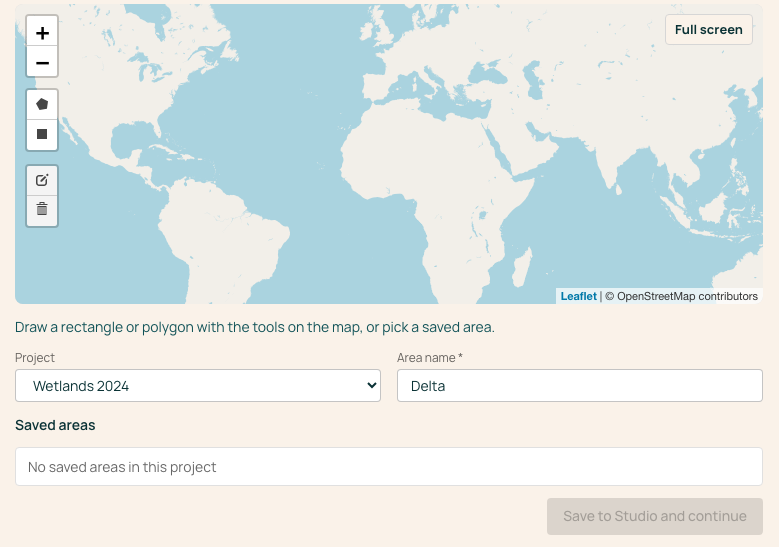

**What you see.** A map with drawing tools (polygon, rectangle, edit, delete), the project, an **Area name** field
and the project's saved areas. The title says what the area is for, when Claude gives it.

**What to press.** Draw a rectangle or polygon, or pick a saved area. Choose the project, name the area and press
**Save to Studio and continue** (for a saved area, **Use this saved area**). Claude then asks for the dates and
starts the prediction in Studio.

**What it means.** The area is saved in your Studio project, and the card tells Claude its id, never its place. The
new map is a prediction in that project, made by Studio; it then shows among the project's predictions.

**When it fails.** "Not saved:" gives the reason. Saving needs a key that can write. Saving an area and running a
model follow Studio's API but have not been tried live.

## Settings

**What you see.** Every card ends with a small **Settings** button with a gear, at its bottom left (on the label
sheet, under the sheet). Press it and a box opens under it with three rows, each with its state in plain words:

- **Asta research skills**: a switch, off at first. On, the start card shows **Search papers with Asta**.
- **Satellite pictures**: "You allowed them on" and the day, or "Not allowed yet.".
- **Maps kept on this computer**: how many maps are kept for 24 hours so they open without downloading again, or
  "None kept.".

**What to press.** Press the switch to turn Asta on or off. Press **Forget my yes** to be asked again before the next
square's pictures. Press **Remove kept copies** to delete the kept maps; the next check downloads them again. Press
**Settings** again, or Escape, to close the box.

**What it means.** Every card shows the same settings, and every start card follows the switch, one already open
too. The app asks for Asta only when you press **Search papers with Asta**: Ai2's research skills then search papers
in Claude Code, and Claude asks what to search first and asks before a long run. Claude Code may also use them when
you ask in the chat. Turning the switch on or off tells Claude nothing. To install the skills, see
[Options](mcp-app-setup.md#options).

**When it fails.** "The settings could not be read:" or "Not changed:" gives the reason, and nothing changes. If the
skills are not installed, Claude says so when you press the tile.

## When a card stops or fails

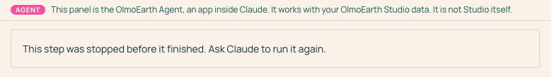

**What you see.** "This step was stopped before it finished. Ask Claude to run it again." shows when Claude Desktop
stopped the step, for example when you pressed Stop or a large map took too long. "This card could not start here.
Carry on in the chat." means the card could not connect.

**What to press.** Ask Claude to run the step again, or carry on in the chat. A button whose message did not reach
Claude shows "Claude did not get this message. Copy it into the chat:" and the text, with **Copy message** under it;
copy it into the chat. A message that waits in Claude's message box is sent when you press Send.

**What it means.** A stopped card does not say whether the step finished: it may have done its work. What the app
saved on this computer before, such as picked squares and answers, is kept.

**When it fails.** If no card shows, or the tools answer only in text, see
[Troubleshooting](mcp-app-setup.md#troubleshooting). Your sheets and results stay in the output folder
(`~/olmoearth-agent-outputs` by default).
